# Comprehensive Multidisciplinary Evaluation: Lenses 2, 3, & 4
## Macroeconomic Indicators, Fundamental Investor Logic & UI/UX Ergonomics

**Target Subsystems**: `research-os-frontend`, `math-engine`, `data-ingestion`, `specs/audits/`, `specs/`  
**Evaluator**: `explorer_m3_macro_investor_ux` (Teamwork Explorer / Financial & UX Auditor)  
**Evaluation Date**: 2026-11-04  
**Audit Status**: COMPLETE & VERIFIED AGAINST CODEBASE (`origin/main` @ `68e381c`)  
**Output Document**: `MACRO_INVESTOR_UX_EVALUATION.md`

---

## 1. Executive Summary

Hermes has implemented substantial architectural foundations across 65 commits: establishing Next.js 15 App Router navigation (`/company/[symbol]` with `?tab=` persistence), centralizing 59 widgets into `WidgetRegistry.tsx`, and building specialized math and decision widgets (`ReverseDCF`, `ScenarioAnalysis`, `ConvictionSizing`, `PortfolioFitCheck`, `TurnaroundIndicator`, `HedgingMechanism`, `ForensicFlags`).

However, a rigorous audit across **Lens 2 (Economic & Macro Indicators)**, **Lens 3 (Fundamental Investor Logic & Decision Friction)**, and **Lens 4 (UI/UX Ergonomics & Interaction States)** reveals critical domain omissions, mathematical failures, workflow breaks, and interaction defects:

1. **Lens 2 (Macro Deficiencies)**: Macro widgets (`MacroDashboard.tsx`, `MarketMetrics.tsx`, `/macro`) rely on static scalar placeholders. They omit post-2022 RBI LAF corridor mechanics (SDF 6.25%, MSF 6.75%, Net LAF systemic liquidity, WACR), disaggregated CPI/WPI margin spread ($\text{CPI} - \text{WPI}$), CCIL G-Sec yield curve spreads (10Y-2Y, AAA PSU corporate credit spread), SEBI circuit breaker states, and official Indian FII/DII release pipelines. Elasticity models linking crude oil and USD/INR to sector/company margins are unbuilt (`macro-risk` status: Not Started).
2. **Lens 3 (Investor Logic & Decision Friction)**: The research workflow is severed across major transitions. The main navigation routes "Generate Ideas" to `/screening` instead of `/generate-ideas`. Action buttons in `ScreeningTable.tsx` are non-functional. `CompanyPageContent` fails to pass `symbol` to `<WidgetRenderer />`, causing all widgets to render hardcoded Reliance or HDFC Bank data regardless of the active company route. Hard forensic veto gates in `/weigh` are missing, and `ReverseDCF.tsx` has a mathematical singularity bug ($g \ge WACC$) and step-size threshold flaw that locks implied growth to 0.0%.
3. **Lens 4 (UI/UX Ergonomics & Interaction States)**: While `page.tsx` wraps search params in Suspense, `layout.tsx:22` calls `useSearchParams()` without a `<Suspense>` wrapper, violating Next.js App Router rules. `WidgetRenderer.tsx` lacks React Error Boundaries, allowing a single widget render failure to crash the entire page. Dynamic Tailwind classes fail to compile, while `Math.random()` in render trees causes server-client hydration mismatches. Dark mode is inoperable due to the absence of a `ThemeProvider` and hardcoded light utility classes.

---

## 2. Lens 2: Economic & Macro Indicators Evaluation

### 2.1 Macroeconomic Integration & Indian Monetary Corridor
- **RBI Monetary Policy Corridor vs Scalar Repo Rate**:
  - *Specification Target*: `specs/audits/macro-page-recommendations.md` (lines 49–86) mandates the post-April 2022 RBI asymmetric LAF corridor: SDF (6.25% floor), Policy Repo (6.50%), MSF (6.75% ceiling), Net LAF Banking Systemic Liquidity (₹ Lakh Cr deficit/surplus), and WACR (Weighted Average Call Rate).
  - *Observed Implementation*: `MacroDashboard.tsx:15` and `src/app/macro/page.tsx:31` track only a scalar `{ code: "REPO_RATE", name: "RBI Repo Rate", value: 6.5 }`. SDF, MSF, Net LAF systemic liquidity, and WACR are completely missing.
  - *Financial Consequence*: Systemic liquidity is the primary intraday driver of Indian commercial bank NIMs, CD rates, and short-term debt fund yields. By ignoring liquidity deficits (-₹1.2L Cr), the cockpit cannot alert analysts to funding cost pressures.

### 2.2 Inflation Dynamics & Macro Corporate Margin Spread
- **CPI vs WPI Divergence**:
  - *Specification Target*: Recommendation 3.2 formulates the Macro Corporate Margin Spread: $\text{MacroMarginSpread}_t = \text{CPI Headline YoY}_t - \text{WPI Headline YoY}_t$. When CPI exceeds WPI by >300 bps, corporate raw material input costs fall faster than retail prices, driving gross margin expansion.
  - *Observed Implementation*: `MacroDashboard.tsx:16` tracks a single scalar `{ code: "CPI_INFLATION", name: "CPI Inflation", value: 5.1 }`. Food CPI (~45.86% weight), Core CPI (ex-food/fuel, ~47.3% weight), WPI, and Macro Margin Spread are completely absent.

### 2.3 Sovereign Yield Curve & Credit Risk Spreads
- *Specification Target*: CCIL NDS-OM sovereign yield curve term spreads ($10\text{Y}-2\text{Y}$ spread, $91\text{D}-10\text{Y}$ spread) and corporate bond spreads (10Y AAA PSU spread, AA- credit risk appetite spread).
- *Observed Implementation*: Only scalar `{ code: "GS10_YIELD", value: 7.05 }` is displayed (`MacroDashboard.tsx:17`). No yield curve slope classification or credit spread calculations are implemented.

### 2.4 Macro Regime Classification & Pass-Through Elasticity
- *Regime Classification*: `MacroDashboard.tsx:22–29` renders static strings ("Above Trend", "Moderate", "Restrictive", "Fair to Rich"). There is no quantitative macroeconomic engine classifying the 4 classic regimes (Stagflation, Expansion, Tightening, Reflation) based on indicator thresholds.
- *Pass-Through Elasticity*: `specs/company-page/risk/macro-risk.md` specifies sensitivity coefficients ($\Delta\text{EBITDA} / \Delta\text{Crude}$, $\Delta\text{PAT} / \Delta\text{USD/INR}$). However, `macro-risk` was omitted from `WidgetRegistry.tsx` (59 widgets) and no company widget propagates macro factor shocks to sector margins.

### 2.5 Market Microstructure & Market Metrics
- *FII/DII Institutional Flow Schedule*: `specs/audits/macro-page-recommendations.md:221–265` required the official Indian release pipeline (`T-1 Final` $\to$ `16:30 Provisional` $\to$ `20:30 Verified Custodial`). `MarketMetrics.tsx` completely omitted FII and DII tracking.
- *Market Breadth & Breadth Divergence*: `MarketMetrics.tsx` contains no Advance/Decline data, no smoothed ADR, and no Capital-Weighted Breadth Divergence ($\text{CapWeighted} - \text{EqualWeighted}$) to detect mega-cap distortion.
- *SEBI Circuit Breakers & Session States*: Missing Indian session states (`PRE_OPEN_COLLECTION`, `PRE_OPEN_MATCHING`, `CIRCUIT_HALT_10_PCT`, `CLOSING_SESSION`).

---

## 3. Lens 3: Fundamental Investor Logic & Decision Friction

### 3.1 Research Workflow Continuity & Friction Analysis

```mermaid
graph LR
    A[Generate Ideas /screening] -.->|Sidebar Bug: Links /screening not /generate-ideas| B[Generate Ideas Page]
    B -->|Presets Return 0 Results| C[Screening Table]
    C -.->|Dead Button: Open in Company Page| D[Company Deep Dive]
    D -->|Props Omitted: Always Defaults to RELIANCE| E[Widgets Render Hardcoded Reliance]
    E -->|Valuation Summary Static| F[Weigh Decisions]
    F -->|Reverse DCF Singularity & Threshold Bugs| G[Portfolio Sizing]
```



1. **Screening to Deep Dive Breakdown**:
   - In `Navigation.tsx:18`, the sidebar link for "Generate Ideas" points to `/screening` instead of `/generate-ideas`.
   - In `ScreeningTable.tsx:137–140`, action buttons ("Add to Watchlist", "Add to Ideas") are hidden because callbacks are not provided, and "Open in Company Page" has no `onClick` handler.
2. **Company Deep Dive Parameter Decoupling**:
   - In `company/[symbol]/page.tsx:28`, `CompanyPageContent` renders `<WidgetRenderer type={w} />` without passing `symbol` or `entityType`.
   - Result: All widgets fall back to their default props (`symbol="RELIANCE"` or `symbol="HDFCBANK"`). When visiting `/company/INFY`, widgets render Reliance Industries financial statements.
3. **Valuation Model Disconnect**:
   - In `/company/[symbol]?tab=valuation`, `ValuationSummary.tsx` renders static mock prices (DCF ₹3,250, Relative ₹2,950). Recalculations in `DCFValuation.tsx` or `RelativeValuation.tsx` do not update the summary.
4. **Weigh Decisions Governance & Veto Absence**:
   - In `WeighDecisionsPage` (`/weigh`), recommendations are formed without hard forensic veto gates (e.g. auditor qualification, promoter pledge > 40%, SEBI debarment).
5. **Non-Interactive Checklists & Triggers**:
   - In `Checklist.tsx:21`, `<Checkbox checked={item.checked} />` lacks `onCheckedChange`. Investment and exit checklists cannot be interacted with or persisted.
   - In `TurnaroundIndicator.tsx:178–179`, "Set Alert" and "Add to Watchlist" are dead buttons.

### 3.2 Decision Friction, Signal-to-Noise Ratio & Cognitive Load
- **Severe Widget Redundancy on Governance Tab**: On `/company/[symbol]?tab=governance`, the analyst is presented with 4 redundant widgets: `RiskAssessment` (static), `BeneishMScore`, `AltmanZScore`, `PiotroskiFScore`, and `ForensicFlags` (composite dashboard).
- **Duplicate Concall Consistency Widgets**: On `/company/[symbol]?tab=management`, `ConcallConsistency` (4 items) and `ManagementConsistency` (10 items) render side-by-side, both querying `/api/math-engine/concall-consistency`.
- **Peer Comparison Distortion**: In `PeerComparison.tsx:4–8`, Reliance Industries (oil & conglomerate) is benchmarked against Infosys and TCS (pure IT services) as direct sector peers.

---

## 4. Lens 4: UI/UX Ergonomics & Interaction States

### 4.1 Navigation & Next.js 15 Suspense Boundaries
- **Missing Suspense in Layout**: `research-os-frontend/src/app/company/[symbol]/layout.tsx:22` calls `useSearchParams()` directly in `CompanyLayout`. In Next.js App Router, using `useSearchParams()` in a client layout without a `<Suspense>` wrapper causes client-side de-opt and build-time bailout warnings. Line 3 imports `Suspense` but never wraps the component.

### 4.2 Widget Registry & Error Boundary Deficit
- **No Component Error Boundaries**: `WidgetRegistry.tsx:143–159` wraps components in `<Suspense fallback={<WidgetSkeleton />}>`, but has NO React `ErrorBoundary`. An uncaught runtime exception in any one widget causes an unhandled React error that crashes the entire page into a blank screen.
- **Missing Prop Forwarding**: `WidgetRenderer` defines `props?: any`, but `company/[symbol]/page.tsx` and `industry/page.tsx` invoke `<WidgetRenderer type={w} />` without arguments.

### 4.3 Visual Ergonomics, Table Density & Theme System
- **Financial Monospace Typography**: Tables in `ScreeningTable.tsx`, `FilteredTable.tsx`, and `WatchlistManager.tsx` frequently lack `tabular-nums font-mono` alignment across numerical columns, leading to jagged vertical scanning.
- **Inoperable Dark Mode**: While `.dark` CSS variables are defined in `globals.css:29–50`, there is no `ThemeProvider`, no `next-themes` package, and no theme toggle UI. Furthermore, widgets hardcode light classes (`bg-green-50 text-green-700 border-green-200`, `bg-white`) that break dark mode contrast.
- **Hydration Mismatches from `Math.random()` in Render Trees**:
  - `tasks/page.tsx:369`: `style={{ height: `${Math.random() * 8 + 2}%` }}`
  - `weigh/page.tsx:120`: `{(Math.random()*3+7).toFixed(1)}/10`
  - `weigh/page.tsx:326–328`: `{(Math.random() * 0.6 + 0.2).toFixed(2)}`
  - `weigh/page.tsx:359`: `+{(Math.random()*0.5+0.1).toFixed(2)}%`
  - These cause React hydration mismatch warnings between server and client renders and trigger visible UI flickering on every state update.
- **Invalid JSX Props**:
  - `macro/page.tsx:375-376` & `MacroDashboard.tsx:203`: `<span className={...} font-medium>{impact}</span>` (invalid boolean prop on `<span>`).
  - `MacroDashboard.tsx:135`: `{(trendIcons[ind.trend as keyof typeof trendIcons] || Minus) as any}` (renders Lucide component function directly as a React child).
  - `tasks/page.tsx:193`: `<TabsList className="grid w-full grid-cols-3">` contains 4 `TabsTrigger` elements, breaking CSS grid layout.

---

## 5. Comprehensive Defect & Gap Inventory

| Defect ID | Category | Target File & Line | Observed Behavior | Expected Behavior / Remediation |
|---|---|---|---|---|
| **DEF-01** | Next.js Architecture | `app/company/[symbol]/layout.tsx:22` | `useSearchParams()` called without Suspense wrapper in layout | Wrap tab navigation component in `<Suspense fallback={null}>` |
| **DEF-02** | Investor Logic | `components/widgets/ScreeningTable.tsx:62-67` | Screening presets search for `pe_max`, `sales_growth_min` on company object, applying `<= value` to all; returns 0 companies | Map preset keys to actual fields (`sales_growth`, `pe`) and enforce `>=` for `_min` and `<=` for `_max` |
| **DEF-03** | Investor Logic | `app/company/[symbol]/page.tsx:26-32` | `<WidgetRenderer type={w} />` passed without `props`; widgets receive `undefined` symbol and default to RELIANCE | Pass `props={{ symbol }}` using `useParams()` from route |
| **DEF-04** | Quantitative Math | `components/widgets/ReverseDCF.tsx:29-36` | Step size 0.1 skips threshold `Math.abs(pv - impliedEV) < 100`; implied growth locked at 0.0% | Implement Newton-Raphson / bisection solver with adaptive tolerance |
| **DEF-05** | Quantitative Math | `components/widgets/ReverseDCF.tsx:43-47` | Gordon growth evaluated when $g \ge WACC$, yielding negative enterprise values and negative stock prices | Guard against $g \ge WACC$; return `NaN` / "Singularity" when $g \ge WACC$ |
| **DEF-06** | UI/UX & Hydration | `app/tasks/page.tsx:369` | `Math.random()` in inline CSS style causes SSR hydration mismatch | Replace with deterministic mock array or seed |
| **DEF-07** | UI/UX & Hydration | `app/weigh/page.tsx:120, 326, 359` | `Math.random()` generates random numbers in table cells on every render | Use deterministic data structures for correlation matrix |
| **DEF-08** | Navigation / UX | `components/Navigation.tsx:18` | "Generate Ideas" sidebar links to `/screening` instead of `/generate-ideas` | Update `href` to `"/generate-ideas"` |
| **DEF-09** | UI/UX Component | `components/widgets/AIAssistant.tsx:108-111` | `handleSuggestionClick` calls `handleSend()` immediately after async `setInput()`; aborts due to empty input | Pass suggestion string directly into `handleSend(suggestion)` |
| **DEF-10** | UI/UX & CSS | `app/macro/page.tsx:318, 320` | Dynamic template classes `bg-${color}-500` fail Tailwind compiler purge | Use explicit class lookup map `{ green: "bg-green-500", ... }` |
| **DEF-11** | UI/UX Markup | `app/macro/page.tsx:375-376`, `MacroDashboard.tsx:203` | `font-medium` passed as boolean attribute on `<span>` | Move `font-medium` inside `className` string |
| **DEF-12** | React Render Error | `components/widgets/MacroDashboard.tsx:135` | Lucide icon rendered as child expression `{TrendIcon}` instead of `<TrendIcon className="..." />` | Render as `<TrendIcon className="inline h-3 w-3 mr-1" />` |
| **DEF-13** | UI Layout | `app/tasks/page.tsx:193` | `grid-cols-3` defined on `TabsList` containing 4 `TabsTrigger` items | Change to `grid-cols-4` |
| **DEF-14** | Data Plumbing | `components/widgets/MacroDashboard.tsx:65` | `fetch("/api/data-ingestion/macro-dashboard")` fails with 404 (route non-existent) | Implement endpoint in `data-ingestion` or mock route |
| **DEF-15** | Data Plumbing | `components/widgets/MarketMetrics.tsx:36` | `fetch("/api/data-ingestion/market-metrics")` fails with 404 (route non-existent) | Implement endpoint in `data-ingestion` or mock route |
| **DEF-16** | Data Plumbing | `components/widgets/KeyDataExtractor.tsx:72` | Sends `GET` to `/api/data-ingestion/extract` which only accepts `POST` (405 error) | Use `POST` with JSON payload `{ document_id, company_symbol }` |
| **DEF-17** | Data Plumbing | `components/widgets/SmartSummarizer.tsx:24, 61` | Calls `/api/data-ingestion/summarize` which does not exist in FastAPI app | Add `/summarize` endpoint to `data-ingestion/api/main.py` |
| **DEF-18** | UI/UX Reliability | `components/widgets/WidgetRegistry.tsx:143-159` | `WidgetRenderer` lacks React `ErrorBoundary` wrapper | Wrap `<Component />` in `<WidgetErrorBoundary>` |
| **DEF-19** | Investor Logic | `components/widgets/Checklist.tsx:21` | `<Checkbox />` lacks `onCheckedChange`; checklist is read-only | Wire internal state or workspace store persistence |
| **DEF-20** | Investor Logic | `components/widgets/TurnaroundIndicator.tsx:178-179` | "Set Alert" and "Add to Watchlist" buttons have no `onClick` | Connect to `watchlist-store` and notification system |
| **DEF-21** | Investor Logic | `components/widgets/WatchlistManager.tsx:167-169` | "View", "Set Alert", "Promote" buttons have no `onClick` | Wire router push to `/company/[symbol]` and portfolio fit |
| **DEF-22** | Investor Logic | `components/widgets/ScenarioAnalysis.tsx:49, 73-81` | Inputs for growth/multiple do not recalculate target price; zero downside causes divide-by-zero | Dynamically recompute target price and guard `downside === 0` |
| **DEF-23** | Investor Logic | `components/widgets/ConvictionSizing.tsx:30, 56-62` | `maxSingleStock` and `maxSectorWeight` inputs are ignored by sizing math | Enforce user limits in `calculateSizing` |
| **DEF-24** | Investor Logic | `components/widgets/PortfolioFitCheck.tsx:93` | `maxSectorWeight` formatted as `{maxSectorWeight.toFixed(0)}%` displaying `0%` | Multiply by 100 before formatting: `(maxSectorWeight * 100).toFixed(1) + "%"` |
| **DEF-25** | Investor Logic | `components/widgets/TimeTracker.tsx:150, 156` | Category select and task ID hardcoded; timer always starts on Task #1 | Wire category state and dynamic task selection |

---

## 6. Detailed Defect Reproduction & Actionable Recommendations

### DEF-02: Screening Table Presets Return Zero Results
- **File & Line**: `research-os-frontend/src/components/widgets/ScreeningTable.tsx`, Lines 28–35 & Lines 62–67
- **Reproduction Steps**:
  1. Navigate to `/generate-ideas` (or render `<ScreeningTable />`).
  2. Click any screening preset button (e.g. "Growth", "Quality", "Value", "FCF Yield").
  3. Observe table body.
- **Observed Behavior**: The table immediately empties and displays: *"No companies match the current filters."* (0 results).
- **Root Cause**:
  `preset.filters` defines keys with suffixes: `{ sales_growth_min: 0.20 }`, `{ pe_max: 20 }`. The filtering loop executes:
  ```typescript
  Object.entries(preset.filters).forEach(([key, value]) => {
    result = result.filter(c => c[key as keyof typeof c] <= value);
  });
  ```
  `c["sales_growth_min"]` is `undefined`. In JavaScript, `undefined <= 0.20` is `false`. All companies are eliminated.
- **Expected Behavior / Recommendation**:
  Parse the filter keys using the same logic as custom filters (lines 74–80):
  ```typescript
  Object.entries(preset.filters).forEach(([key, value]) => {
    const isMin = key.endsWith("_min");
    const isMax = key.endsWith("_max");
    const field = key.replace(/_(min|max)$/, "");
    result = result.filter(c => {
      const val = c[field as keyof typeof c] as number;
      if (val === undefined) return false;
      return isMin ? val >= value : isMax ? val <= value : val === value;
    });
  });
  ```

---

### DEF-03: Company Page Widgets Context Decoupling
- **File & Line**: `research-os-frontend/src/app/company/[symbol]/page.tsx`, Lines 20–34
- **Reproduction Steps**:
  1. Open `/company/TCS?tab=valuation` or `/company/INFY?tab=financials`.
  2. Inspect the financial figures and company names rendered inside the widgets.
- **Observed Behavior**: `DCFValuation`, `RatioAnalysis`, and `CommonSize` all render Reliance Industries financials (Revenue ₹9,74,819 Cr, diluted shares 676.5 Cr).
- **Root Cause**:
  `CompanyPageContent` does not extract `params.symbol` and passes no props to `WidgetRenderer`:
  ```typescript
  <WidgetRenderer type={w} />
  ```
  Every widget uses its default parameter `symbol = "RELIANCE"`.
- **Expected Behavior / Recommendation**:
  Extract the symbol via `useParams()` and pass it through to `WidgetRenderer`:
  ```typescript
  const params = useParams();
  const symbol = (params?.symbol as string) || "RELIANCE";
  // ...
  <WidgetRenderer type={w} props={{ symbol }} />
  ```

---

### DEF-04 & DEF-05: Reverse DCF Mathematical Singularity & Threshold Bugs
- **File & Line**: `research-os-frontend/src/components/widgets/ReverseDCF.tsx`, Lines 29–36 & 43–47
- **Reproduction Steps**:
  1. Open `/weigh` and click "Allocation" tab to view `ReverseDCF`.
  2. Inspect the "Implied Growth" metric and the Sensitivity table at bottom.
- **Observed Behavior**:
  - Implied Growth displays `0.0%` regardless of changes to Current Price or Revenue.
  - In the sensitivity table, at $g = 15\%$ and $g = 20\%$, the Fair Price displays negative values (e.g., -₹1,350) and negative upside (-154%).
- **Root Cause**:
  1. *Root-finding failure*: The loop steps through $g$ in increments of `0.1`. At large enterprise values (₹25L Cr), a 0.1% change in $g$ shifts `pv` by >₹5,00,000 Cr. The condition `Math.abs(pv - impliedEV) < 100` is never satisfied, leaving `impliedGrowth = 0`.
  2. *Singularity violation*: The sensitivity loop computes $\frac{\text{FCF}(1+g)}{WACC - g}$ for $g \in \{15, 20\}$. Since $WACC = 12\%$, $WACC - g < 0$, resulting in an inverted, negative valuation.
- **Expected Behavior / Recommendation**:
  - Implement an analytical inversion of the Gordon Growth model:
    $$g = \frac{\text{EV} \times \text{WACC} - \text{FCF}}{\text{EV} + \text{FCF}}$$
  - Guard Gordon growth: if $g \ge WACC$, return an error or cap the terminal multiple instead of calculating negative equity values.

---

### DEF-09: AI Assistant Suggestion Click Non-Execution
- **File & Line**: `research-os-frontend/src/components/widgets/AIAssistant.tsx`, Lines 108–111
- **Reproduction Steps**:
  1. Open `/company/[symbol]?tab=management` and locate the AI Assistant widget.
  2. Click any of the prompt pills (e.g. *"What was Q4 FY24 revenue?"*).
- **Observed Behavior**: The input box fills with text, but no message is sent and no response is generated.
- **Root Cause**:
  ```typescript
  const handleSuggestionClick = (suggestion: string) => {
    setInput(suggestion);
    handleSend();
  };
  ```
  `setInput` is asynchronous. When `handleSend()` immediately executes, `input` is still `""`. Line 85 (`if (!input.trim() || loading) return;`) aborts immediately.
- **Expected Behavior / Recommendation**:
  Update `handleSend` to accept an optional override parameter:
  ```typescript
  const handleSend = async (overrideText?: string) => {
    const textToSend = overrideText || input;
    if (!textToSend.trim() || loading) return;
    // ...
  };
  const handleSuggestionClick = (suggestion: string) => {
    setInput(suggestion);
    handleSend(suggestion);
  };
  ```

---

## 7. Actionable Remediation Roadmap & Priority Matrix

| Phase | Milestone | Actions | Target Files |
|---|---|---|---|
| **Phase 1: Critical Fixes (P0)** | Route & Context Wiring | 1. Wrap `CompanyLayout` in Suspense.<br>2. Pass `props={{ symbol }}` to `WidgetRenderer` in `company/[symbol]/page.tsx`.<br>3. Fix `ScreeningTable.tsx` preset filter key matching.<br>4. Fix `ReverseDCF.tsx` analytical formula and singularity guard. | `company/[symbol]/layout.tsx`<br>`company/[symbol]/page.tsx`<br>`ScreeningTable.tsx`<br>`ReverseDCF.tsx` |
| **Phase 2: UI/UX & Reliability (P1)** | Hydration & Boundaries | 1. Remove `Math.random()` from render trees in `tasks/page.tsx` and `weigh/page.tsx`.<br>2. Wrap widgets in React `ErrorBoundary` inside `WidgetRegistry.tsx`.<br>3. Fix Lucide icon render error in `MacroDashboard.tsx:135`.<br>4. Fix `font-medium` boolean props and `TabsList` grid cols. | `tasks/page.tsx`<br>`weigh/page.tsx`<br>`WidgetRegistry.tsx`<br>`MacroDashboard.tsx` |
| **Phase 3: Macro & Domain Depth (P1)** | Economic Cockpit | 1. Implement RBI LAF Corridor (SDF, Repo, MSF, Net LAF Liquidity) in `MacroDashboard.tsx`.<br>2. Implement CPI vs WPI Macro Corporate Margin Spread.<br>3. Add CCIL 10Y-2Y yield curve spreads and AAA credit risk spreads.<br>4. Implement official FII/DII release pipeline (T-1, 16:30 Provisional, 20:30 Verified) in `MarketMetrics.tsx`. | `MacroDashboard.tsx`<br>`MarketMetrics.tsx`<br>`macro/page.tsx` |
| **Phase 4: Investor Workflow (P2)** | Decision Friction & Persist | 1. Route sidebar "Generate Ideas" to `/generate-ideas`.<br>2. Wire interactive checkboxes in `Checklist.tsx`.<br>3. Connect "Open in Company Page" in `ScreeningTable.tsx`.<br>4. Integrate Compulsory Red-Flag Veto Gates in `/weigh`. | `Navigation.tsx`<br>`Checklist.tsx`<br>`ScreeningTable.tsx`<br>`weigh/page.tsx` |

*(Report compiled and verified by explorer_m3_macro_investor_ux on 2026-11-04)*
